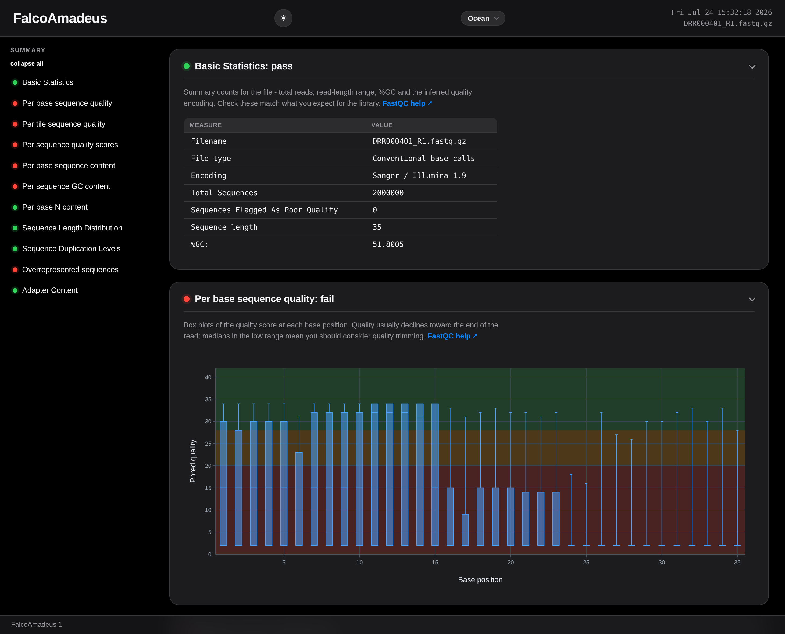
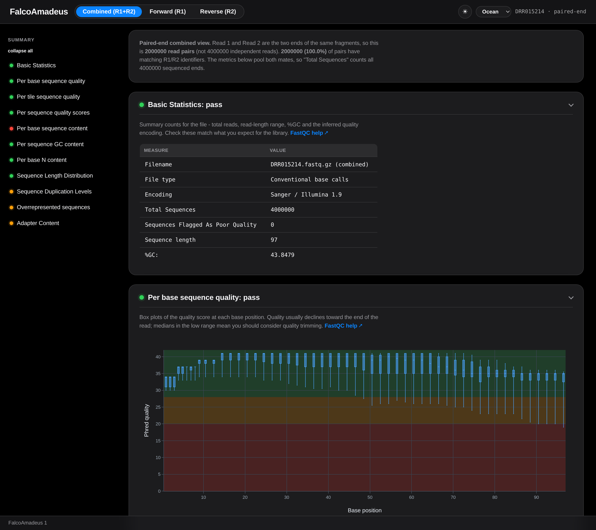
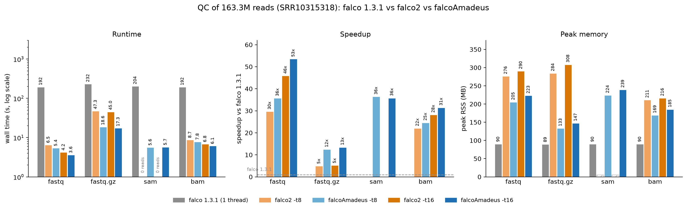

# FalcoAmadeus: a faster, sequencing-aware falco

**FalcoAmadeus** is a performance-focused fork of
[falco](https://github.com/smithlabcode/falco) (itself an emulation of the
popular [FastQC](https://www.bioinformatics.babraham.ac.uk/projects/fastqc)
software) that checks large sequencing reads for common problems.

By default it produces the same output as upstream falco 1.3.2 with one
corrected grade: Per base N content is graded as in FastQC (warn above 5 %,
fail above 20 % N at a position), where falco 1.x never warns or fails because
it compares a fraction with the percent limits. With
`--legacy-n-content-grade`, a plain single-end run's `fastqc_data.txt` and
`summary.txt` are byte-identical to those of falco 1.3.2 (checked in CI). The
speed work never changes results. Everything else new below is **opt-in**
behind a flag or a new mode.

## Why this fork exists

These optimizations were offered to upstream falco as a patch, but the
maintainers declined to merge it. FalcoAmadeus exists to make the faster
implementation available to users who want it, and to add the sequencing-aware
and reporting features below, while keeping the output identical to the
original apart from the corrected N-content grade.

## What FalcoAmadeus does differently

- **Paired-end analysis** (`--paired-with R2`). FastQC and falco process one
  file at a time, so sequence duplication is assessed per mate: two fragments
  that share only one end count as duplicates. FalcoAmadeus analyses the pair
  together and writes **one combined HTML report** with **Combined / Forward /
  Reverse** tabs, where *Combined* pools R1+R2 as a single dataset (GC,
  adapters, content, quality measured over all reads at once). It first checks
  that the mates are in matching order (identical read identifiers) and
  rejects inputs where they are not (`--allow-unmatched-pairs` overrides).
  `paired_duplication.txt` reports the **paired sequence duplicate rate**,
  where a pair is a copy only when *both* mates match, counted exactly over
  all reads and therefore independent of read order, next to the per-mate
  rates and the FastQC-style estimates for comparison with FastQC/falco.
  On request the report adds an **error- and UMI-aware rate**:
  `--dup-mismatches N` lets the mates of two copies differ in up to N bases in
  total (copies with sequencing errors), and `--umi-r1`/`--umi-r2 START:LEN`
  or `--umi-in-name` keep pairs with different unique molecular identifiers
  apart (`--umi-mismatches` tolerates errors in the UMI). Candidates are found
  through k-mer blocks shared by both mates and confirmed base by base, so the
  rate stays exact for the stated tolerance and independent of read order.
  The same options work for single-end input, where a read is the unit and
  the rate is written to `aware_duplication.txt`.

- **Machine-readable summary.** Every run writes
  `falcoAmadeus_summary.json` (all metrics per view and of the falcoAmadeus
  reports, plus the share of bases with Phred quality 20 and 30 or more) and
  `falcoAmadeus_mqc.json`, which MultiQC shows as general statistics columns
  (Q30 bases, paired and aware duplication, complexity, insert size, adapter
  read-through and dimers, screen).

- **Contamination screen.** `--screen DB` estimates which share of the
  reads comes from each genome of a reference panel (human, mouse, rat,
  fly, worm, yeast, Arabidopsis, E. coli, PhiX, lambda, mitochondria, rRNA,
  mycoplasma, vectors) without alignment: canonical 31-mers selected by
  hash (FracMinHash), low-complexity k-mers skipped on both sides, in
  `screen.txt` (found per reference, found only there, no reference).
  `--screen-build DB --screen-refs name=fasta,...` builds the database from
  any FASTA files (about 40 MB and 15 s for the panel above);
  `paper/scripts/screen_validation` lists the public references used.

- **Insert size and adapter read-through (paired).** From the overlap of
  read 1 with the reverse complement of read 2 in the first million pairs,
  `paired_insert_size.txt` gives the insert-size histogram (as fastp's
  overlap analysis; equal histograms on the same pairs), the share of pairs
  whose insert is shorter than a read, the adapter each read continues into
  (named when it is a known adapter), and the adapter dimers.
  `--insert-size-pairs N` sets the number of pairs (0: all).

- **Library complexity.** From how many distinct sequences were seen once,
  twice and so on, `paired_duplication.txt` reports how many distinct pairs
  to expect at 2x to 100x the sequenced pairs, so a library can be judged
  for further sequencing before alignment. The estimate is a port of the
  `preseq lc_extrap` yield curve (quick mode) and gives the same values as
  preseq on the same counts. `--complexity` adds it for single-end input
  (`complexity.txt`).
  Sequence duplication reflects PCR duplicates as well as natural redundancy
  (deep coverage, highly expressed or enriched loci). Per-mate
  `fastqc_data.txt` files are kept for MultiQC.

- **Assay-aware QC** (`--assay <type>`). Tunes each module's pass/warn/fail
  expectations to the library type (`rnaseq`, `amplicon`, `wgbs` bisulfite/EM,
  `chipseq`, `atac`, `smallrna`, `wgs`, …), so genuinely expected base-content
  patterns (e.g. the C→T depletion of bisulfite libraries) are annotated and
  not flagged as failures.

- **A beautified, interactive HTML report.** The report (now named
  `falcoAmadeus_report.html`) has a modern, responsive design: collapsible
  modules with plain-language explanations and FastQC documentation links, a
  **light/dark theme toggle**, **selectable colourblind-safe colour palettes**
  that also recolour the box plot and per-tile heatmap, readable unified
  hover tooltips, and cleaner plots (a proper box-and-whisker per-base-quality
  plot over pass/warn/fail zones, a padded length-distribution histogram, …).

- **MultiQC-friendly.** The `fastqc_data.txt` output is ingested by MultiQC as a
  FastQC report. `--name NAME` sets an explicit sample name (so inputs passed
  with unhelpful names — e.g. Galaxy paired-collection elements all called
  *forward*/*reverse* — stay distinct instead of collapsing), and
  `--paired-data mates|combined|both` chooses whether MultiQC gets the two mates
  separately or a single pooled sample per pair.

- **Multi-threaded parsing of every input format** (`-t N`). FASTQ, gzipped
  FASTQ, SAM and BAM all parse in parallel, and the same fast drivers serve
  single-threaded runs too. Output is byte-identical to upstream falco at
  every thread count.

A Galaxy tool wrapper exposing these features is maintained separately as
`tools-iuc/tools/falcoAmadeus`.

## Screenshots

The redesigned report, in light and dark themes:

| Light | Dark |
| :---: | :---: |
| [](img/report_light.png) | [](img/report_dark.png) |

Paired-end combined report (Combined / Forward / Reverse tabs, with the
read-pair summary at the top):

[](img/report_paired.png)

## Speed improvements

FalcoAmadeus replaces falco's serial input path with parallel, format-aware
drivers, while keeping the output byte-identical (verified against the
upstream checksum suite and against single-threaded output at every thread
count, for every change):

- **Parallel parsing for every input format.** Uncompressed FASTQ and SAM are
  memory-mapped and parsed in place across record-aligned byte ranges. BAM is
  decompressed and parsed in overlapped, double-buffered chunks (BGZF blocks
  inflate in parallel with libdeflate). Plain gzip inflates with ISA-L into
  bounded chunks that are parsed in parallel while the next chunk
  decompresses. Single-core runs use the same drivers, so `-t 1` is fast too.
- **SIMD statistics kernels** (AVX-512 on x86, NEON on ARM, scalar fallback):
  the sequence pass (separator scan, N detection, GC, per-position base
  composition into small cache-resident accumulator tiles), the quality pass,
  chain-free adapter window probes, and BAM's packed-base decode including
  reverse-complement.
- **Order-exact parallel bookkeeping.** Everything order-dependent (the
  duplication tracker's first-100k-unique semantics, the floating-point GC
  model, read subsampling) reproduces the serial trajectory exactly; that is
  what keeps the output byte-identical rather than approximately equal.
- **Bounded memory.** Inputs stream through reused chunk buffers with
  drop-behind page management, so peak memory stays flat (roughly 35 to
  250&nbsp;MB depending on format and thread count) no matter how large the
  input is.

### Benchmark: 163 million reads, three tools, four formats

Wall time on 163,264,569 reads (SRR10315318), AMD Ryzen 9 7950X (16
cores/32 threads), 125&nbsp;GB RAM, NVMe storage, warm page cache; medians of
two interleaved runs (falco 1.3.1 is single-threaded and was run once per
format):

| Input | falco 1.3.1 | falco2 `-t 8` | FalcoAmadeus `-t 8` | falco2 `-t 16` | FalcoAmadeus `-t 16` |
| ----- | ----------: | ------------: | ------------------: | -------------: | -------------------: |
| FASTQ (38.8&nbsp;GB)    | 192.5&nbsp;s | 6.5&nbsp;s  | **5.4&nbsp;s**  | 4.2&nbsp;s  | **3.6&nbsp;s**  |
| FASTQ.gz (4.4&nbsp;GB)  | 231.6&nbsp;s | 47.3&nbsp;s | **18.6&nbsp;s** | 45.0&nbsp;s | **17.3&nbsp;s** |
| SAM (39.1&nbsp;GB)      | 203.7&nbsp;s | n/a*        | **5.6&nbsp;s**  | n/a*        | **5.7&nbsp;s**  |
| BAM (4.0&nbsp;GB)       | 191.5&nbsp;s | 8.7&nbsp;s  | **7.8&nbsp;s**  | 6.8&nbsp;s  | **6.1&nbsp;s**  |

Peak resident memory for the same runs:

| Input | falco 1.3.1 | falco2 `-t 8` | FalcoAmadeus `-t 8` | falco2 `-t 16` | FalcoAmadeus `-t 16` |
| ----- | ----------: | ------------: | ------------------: | -------------: | -------------------: |
| FASTQ    | 90&nbsp;MB | 276&nbsp;MB | **205&nbsp;MB** | 290&nbsp;MB | **223&nbsp;MB** |
| FASTQ.gz | 89&nbsp;MB | 284&nbsp;MB | **133&nbsp;MB** | 308&nbsp;MB | **147&nbsp;MB** |
| SAM      | 90&nbsp;MB | n/a*        | 224&nbsp;MB     | n/a*        | 239&nbsp;MB     |
| BAM      | 90&nbsp;MB | 211&nbsp;MB | **169&nbsp;MB** | 216&nbsp;MB | **185&nbsp;MB** |

\* falco2 reads 0 of the 163.3M records from this samtools-generated SAM
file, so its SAM cells are not comparable. FalcoAmadeus and falco 1.3.1 both
process all reads.

FalcoAmadeus is faster than falco2 in every valid cell while using less
memory, and 12x (gzip) to 53x (FASTQ) faster than single-threaded falco
1.3.1. At `-t 1` it also beats falco2's single-core runs on every format
(measured on a 30M-read set: FASTQ 4.1&nbsp;s vs 5.7&nbsp;s, gzip 5.2&nbsp;s
vs 9.7&nbsp;s, BAM 5.9&nbsp;s vs 7.9&nbsp;s, at 4 to 8 times less memory).

[](img/benchmark_3tool_163M.png)

The binary is installed and invoked as `falcoAmadeus`. Apart from the program
name and the added options above, all usage is identical to upstream falco.

Installing FalcoAmadeus
=======================

## Installing through conda

If you use [anaconda](https://anaconda.org) to manage your packages, and the
`conda` binary is in your path, you can install `falcoAmadeus` with

```
$ conda install -c bioconda falcoamadeus
```

The `falcoAmadeus` binary can be found inside the `bin` directory of your
anaconda installer.

> **Note:** the bioconda package is being submitted. Until it lands, build from
> source (below). The bioconda recipe lives in [`recipe/`](recipe/); publishing
> version 2 requires pushing a `v2` release tag to this repository, filling in
> the tarball `sha256` in [`recipe/meta.yaml`](recipe/meta.yaml), and opening a
> pull request against
> [bioconda-recipes](https://github.com/bioconda/bioconda-recipes). The conda
> build links htslib, libdeflate and ISA-L, so it ships with full performance
> on all input formats.

## Installing from a source release

Download a release from the
[releases](https://github.com/joachimwolff/falcoAmadeus/releases) section of
this repository. Extract the `.tar.gz` or `.zip`, `cd` into the extracted
directory (which contains a `configure` script), and run

```
$ ./configure CXXFLAGS="-O3 -Wall"
$ make all
$ make install
```

To install to a specific location, pass `--prefix` to `./configure`:

```
$ ./configure CXXFLAGS="-O3 -Wall" --prefix=/path/to/installation/directory
```

The `falcoAmadeus` binary will be found in the `bin` directory inside the
specified prefix.

## Installing from a cloned repository

For the most recent code (which may contain undocumented bugs), clone the
repository and generate the build system with `autoreconf`:

```
$ git clone https://github.com/joachimwolff/falcoAmadeus.git
$ cd falcoAmadeus
$ ./autogen.sh
$ ./configure CXXFLAGS="-O3 -Wall"
$ make all
$ make install
```

### Required C++ dependencies

[zlib](https://zlib.net) is required to read gzip-compressed FASTQ files. It is
usually installed by default on UNIX systems and is part of the htslib setup,
but can also be installed with apt, brew or conda.

On Ubuntu:

```
$ sudo apt install zlib1g zlib1g-dev
```

### Optional C++ dependencies

All of these are optional, detected at configure time, and fall back
gracefully when absent -- but the first two are strongly recommended, since
the fast parallel BAM and gzip paths depend on them:

- [htslib](https://github.com/samtools/htslib) is required to process BAM
  files (without it BAM is treated as an unrecognized format). Enable with
  `--enable-hts`.
- [libdeflate](https://github.com/ebiggers/libdeflate) powers parallel BGZF
  block decompression (BAM and bgzip-compressed FASTQ). Detected
  automatically when the header and library are installed.
- [ISA-L](https://github.com/intel/isa-l) roughly doubles plain-gzip
  decompression speed. Detected automatically.
- [rapidgzip](https://github.com/mxmlnkn/rapidgzip) (header-only) can
  decompress even a single plain-gzip stream in parallel. Build with
  `--with-rapidgzip=<checkout>/librapidarchive/src` and enable per run with
  `FA_RAPIDGZIP=1`; worthwhile for very large plain-gzip files on machines
  with spare cores and memory.

A typical full-performance build:

```
$ ./configure CXXFLAGS="-O3 -Wall" --enable-hts
```

with htslib, libdeflate and ISA-L installed where the compiler can find them
(add their locations to `CPPFLAGS`/`LDFLAGS` if they live in a non-default
prefix, e.g. a conda environment).

Running FalcoAmadeus
====================

Run FalcoAmadeus with the following command, where `example.fq` can be replaced
with any FASTQ/FASTQ.gz/SAM/BAM file:

```
$ falcoAmadeus example.fq
```

This generates three files in the output directory:

* `fastqc_data.txt` — a text summary of the QC metrics (ingestible by MultiQC).
* `falcoAmadeus_report.html` — the interactive HTML report.
* `summary.txt` — a tab-separated pass/warn/fail result for each module.

**Paired-end** (one combined report + per-mate data for MultiQC +
`paired_duplication.txt`):

```
$ falcoAmadeus R1.fastq.gz --paired-with R2.fastq.gz -o out/
```

with copies allowed to differ in two bases, and an 8 nt UMI at the start of
read 2 that may carry one error:

```
$ falcoAmadeus R1.fastq.gz --paired-with R2.fastq.gz --dup-mismatches 2 \
    --umi-r2 1:8 --umi-mismatches 1 -o out/
```

**Assay-aware grading** (here for a bisulfite / EM-seq library):

```
$ falcoAmadeus reads.fastq.gz --assay wgbs -o out/
```

### Options

FalcoAmadeus-specific options:

| Option | Description |
| --- | --- |
| `--paired-with R2` | Analyse the R2 mate together with the R1 positional input; write one combined report and `paired_duplication.txt`. Rejects mates whose read identifiers disagree. |
| `--allow-unmatched-pairs` | With `--paired-with`, proceed even when R1/R2 read identifiers disagree. |
| `--dup-mismatches N` | Also report a duplicate rate in which copies may differ in up to N bases (at most 8): over both mates with `--paired-with` (`paired_duplication.txt`), per read otherwise (`aware_duplication.txt`). |
| `--umi-r1 START:LEN`, `--umi-r2 START:LEN` | The UMI lies in read 1 or read 2 at a 1-based position; pairs are copies only when their UMIs agree, and the UMI bases are left out of the sequence comparison. |
| `--umi-in-name` | The UMI is the last `:` or `_` separated field of the read 1 name (bcl-convert, UMI-tools extract, fastp). |
| `--umi-mismatches N` | Bases in which the UMIs of two copies may differ (default 0). |
| `--screen DB` | Contamination screen against a database from `--screen-build`; writes `screen.txt`. |
| `--screen-reads N` | Reads per file for `--screen` (default 1000000; 0: all). |
| `--screen-build DB` with `--screen-refs name=file,...` | Build a screen database from FASTA files (at most 32 references), then exit. |
| `--insert-size-pairs N` | With `--paired-with`, the number of pairs (from the start) whose mate overlap gives `paired_insert_size.txt` (default 1000000; 0: all). |
| `--complexity` | Single-end: count every read's duplication key exactly and write `complexity.txt` with the expected distinct reads at 2x to 100x the sequenced reads (paired input reports it in `paired_duplication.txt` always). |
| `--paired-data mates\|combined\|both` | With `--paired-with`, which `fastqc_data.txt` files to emit for MultiQC: separate mates (default), a single pooled sample, or both. |
| `--assay TYPE` | Assay-aware pass/warn/fail grading (`rnaseq`, `amplicon`, `wgbs`/`emseq`/`rrbs`, `chipseq`, `atac`, `smallrna`, `wgs`, …; default `generic` is byte-identical to falco). |
| `--conversion-residual F` | For bisulfite/EM assays, the unconverted fraction outside CpG (0–1; C among C+T followed by a base other than G in C→T reads, G among G+A preceded by a base other than C in G→A reads; each read's strand from its composition) above which a possible incomplete-conversion warning is emitted (default 0.2). |
| `--legacy-n-content-grade` | Grade Per base N content as falco 1.x does (never warns or fails), for output byte-identical to falco 1.3.2. |
| `--name NAME` | Sample name for the report `Filename` / MultiQC, instead of the input basename. |
| `-t, --threads N` | Parse with N threads; works for FASTQ, gzipped FASTQ, SAM and BAM (byte-identical output at every thread count). |

The FastQC-compatible options carried over from falco — `-o/--outdir`,
`-f/--format`, `-c/--contaminants`, `-a/--adapters`, `-l/--limits`, `--nogroup`,
`-s/-subsample`, `-b/-bisulfite`, `-r/-reverse-complement`, the `-skip-*` flags
and `-D`/`-R`/`-S` filename overrides — are unchanged. (The FastQC dummy flags
that falco silently ignored, such as `--casava`, `--nano`, `--extract`,
`--java`, `--kmers`, `--dir` and `--min_length`, have been dropped.)

Run `falcoAmadeus --help` for the complete list.

Copyright and license
=====================

FalcoAmadeus is a **fork** of falco.

* The original falco code is Copyright (C) 2019–2022 Guilherme de Sena Brandine
  and Andrew D. Smith, released under the GNU General Public License. Their
  authorship of the original work is gratefully acknowledged.
* The FalcoAmadeus fork and all modifications to it — the parallel parser, the
  paired-end analysis, assay-aware grading, the redesigned HTML report, the new
  command-line options, and everything else added here — are
  Copyright (C) 2026 Joachim Wolff.

FalcoAmadeus is free software: you can redistribute it and/or modify it under
the terms of the GNU General Public License as published by the Free Software
Foundation, either version 3 of the License, or (at your option) any later
version.

This software is distributed in the hope that it will be useful, but WITHOUT
ANY WARRANTY; without even the implied warranty of MERCHANTABILITY or FITNESS
FOR A PARTICULAR PURPOSE. See the GNU General Public License for more details.
