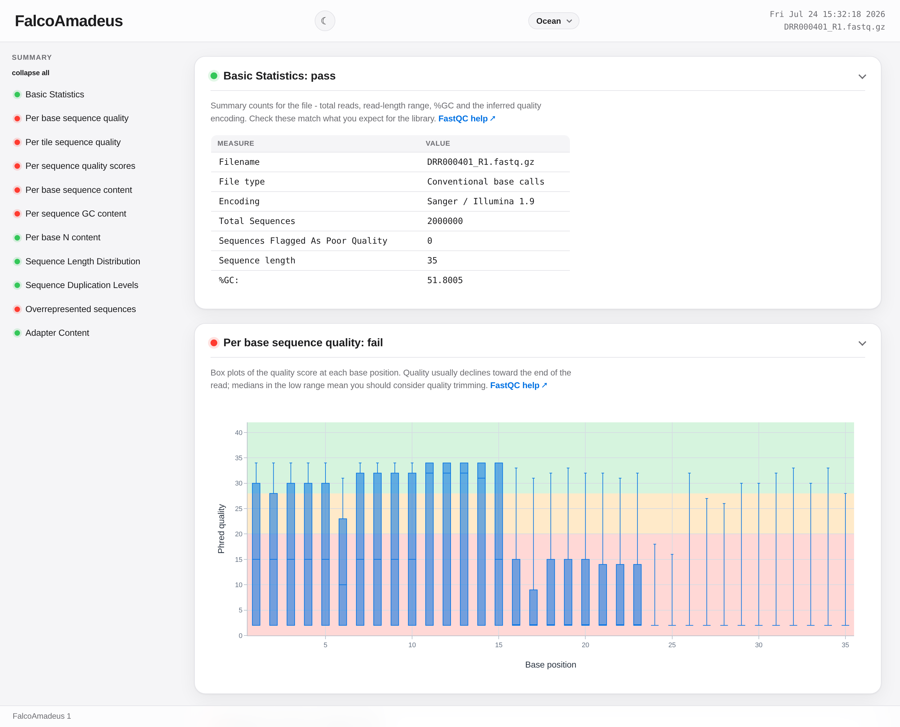

# falcoAmadeus

**falcoAmadeus** is a fork of [falco](https://github.com/smithlabcode/falco), the C++ emulation of
[FastQC](https://www.bioinformatics.babraham.ac.uk/projects/fastqc). It writes the FastQC report of
falco and, from the same pass over the raw reads, the library statistics that decide whether a
library is sequenced deeper, trimmed or prepared again: duplicate and optical duplicate fragments,
library complexity, insert sizes and adapter dimers, contamination by other organisms and the
diversity of unique molecular identifiers (UMIs). No alignment is needed.

## Why falcoAmadeus

- **Statistics of the library, not only of single reads.** Paired duplicate rates (exact, or
  tolerating sequencing errors and requiring UMIs to agree), optical duplicates, a complexity
  curve, insert sizes, a contamination screen, a trimming preview and UMI quality, all in one run.
  See [Statistics beyond FastQC](statistics.md).
- **Ported methods, same values.** Where a statistic follows a published method (preseq, fastp,
  cutadapt, Picard's optical duplicate rule), falcoAmadeus ports it and gives the same values as the
  original program on the same reads.
- **Compatible report.** For single-end input, `fastqc_data.txt` and `summary.txt` equal those of
  falco 1.3.2 apart from a corrected N-content grade (identical with `--legacy-n-content-grade`,
  checked in CI), so MultiQC and existing parsers read them unchanged.
- **Assay-aware grading and acceptance rules.** Profiles for eleven assay types, laboratory limits
  per sample, a JSON summary and MultiQC general-statistics columns.
- **Fast.** Every input format (FASTQ, gzip and BGZF FASTQ, SAM, BAM) is parsed in parallel;
  faster than falco 2.0.3 with less memory in every configuration measured
  (see [Benchmarks](benchmarks.md)).

## At a glance

```bash
# install
conda install -c bioconda falcoamadeus

# single-end report
falcoAmadeus -t 8 -o out/ reads.fastq.gz

# paired-end: one combined report, paired duplication, insert size and complexity
falcoAmadeus -t 8 -o out/ R1.fastq.gz --paired-with R2.fastq.gz

# copies may differ in two bases, 8 nt UMI at the start of read 2
falcoAmadeus -t 8 -o out/ R1.fastq.gz --paired-with R2.fastq.gz \
    --dup-mismatches 2 --umi-r2 1:8 --optical
```



## Where to go next

- [Installation](installation.md): Bioconda, build from source, Galaxy.
- [Usage](usage.md): single-end and paired-end runs, the optional analyses, output files.
- [Statistics beyond FastQC](statistics.md): what each additional statistic measures and how it
  was validated.
- [Options](options.md): the full option reference with defaults.
- [Benchmarks](benchmarks.md): runtime and memory against falco 2.0.3, falco 1.3.2 and FastQC.
- [Support and citation](support.md): where to get help and how to cite.
